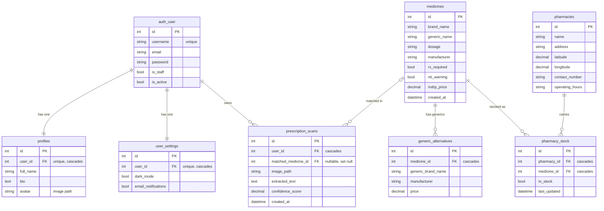

# GeneRX

GeneRX is a Django class project for CSIT327. It helps a patient look up a brand-name medicine, compare sample generic alternatives, check which sample pharmacy lists it in stock, and keep a simple scan history.

The app uses plain Django function-based views, Django templates, and small vanilla JavaScript files. There is no DRF, React, or build step.

## What works

- Register, log in, log out, edit a profile, and save settings.
- Show or hide the password on the login and registration forms.
- Upload a profile photo; it replaces the initial in the navigation bar and survives logout and login.
- Search medicines by brand or generic name through JSON endpoints.
- View generic alternatives with sample prices.
- Filter a pharmacy list by medicine and see sample stock.
- Browse the whole stock ledger (`/pharmacies/stock/`): one JOIN query pairs every stock row with its pharmacy and medicine.
- Check the restock watch (`/pharmacies/restock/`): a SUBQUERY lists only the pharmacies with an out-of-stock item, and shows which medicine.
- Sort pharmacies A-Z or nearest-first with browser geolocation.
- Open Google Maps driving directions from each pharmacy's verified coordinates.
- Upload a prescription image (JPG, PNG, WebP, max 5 MB) and read the printed text with real OCR (RapidOCR), with or without a typed name.
- Match a name with `difflib`, confirm medium-confidence matches, and save scan history.
- Toggle dark mode across the signed-in pages.
- Seed the database with repeatable sample medicines and pharmacies.

## Stack

- Python 3.12+ / Django 5 or 6
- PostgreSQL on Supabase through `DATABASE_URL`
- SQLite fallback when `DATABASE_URL` is empty
- `python-dotenv` for local `.env` loading
- Pillow for image validation and profile photos
- RapidOCR (ONNX Runtime) for prescription text extraction, models bundled in the wheel
- HTML templates, CSS, and vanilla JavaScript

## Project structure

```text
CSIT327-GeneProj/
|-- apps/
|   |-- home/              Home page (search screen)
|   |-- login/             Login and POST-only logout
|   |-- register/          Registration with password validation
|   |-- user_profile/      Profile page and Profile model
|   |-- user_settings/     Settings page, model, and context processor
|   |-- medicines/         Medicine models, JSON search, seed_medicines
|   |-- pharmacies/        Pharmacy models, locator page, seed_pharmacies
|   `-- scans/             Scan models, upload view, difflib matching, OCR placeholder
|-- config/                Settings, root URL conf, WSGI/ASGI
|-- templates/
|   |-- home/
|   |-- login/
|   |-- register/
|   |-- profile/
|   |-- user_settings/
|   |-- pharmacies/
|   `-- scans/
|-- static/
|   |-- css/shared/theme.css   Shared design tokens and shell
|   |-- css/<feature>/         Page-specific styles
|   |-- js/<feature>/          Page-specific scripts
|   `-- images/<feature>/
|-- media/                 Uploaded scans (git-ignored)
|-- manage.py
|-- requirements.txt
`-- README.md
```

Each feature owns its app, template folder, and static folders. Feature apps do not import each other in Python; cross-feature lookups use string model references or `django.apps.apps.get_model()`.

## Data model (ERD)

The diagram is Mermaid UML, so GitHub and VS Code render it as a real ER diagram instead of ASCII art. Entity names are the exact `db_table` values every model sets explicitly.



Relationships in words:

| Relationship | Cardinality | Notes |
|---|---|---|
| `auth_user` → `profiles` | 1:1 | `OneToOneField`, cascade delete |
| `auth_user` → `user_settings` | 1:1 | `OneToOneField`, cascade delete |
| `auth_user` → `prescription_scans` | 1:M | a user owns every scan; history filters on `request.user` |
| `medicines` → `generic_alternatives` | 1:M | one brand medicine has many generic equivalents |
| `medicines` ↔ `pharmacies` | M:M | resolved by the `pharmacy_stock` junction table |
| `medicines` → `prescription_scans` | 1:M (optional) | `matched_medicine` is null until a match is saved or confirmed |

Django's own tables (`auth_user`, `auth_group`, `auth_permission`, `django_content_type`, `django_admin_log`, `django_session`, `django_migrations`) are framework tables and are not redefined here.

## Setup

Open PowerShell in the project folder.

```powershell
# 1. Create and activate a virtual environment
python -m venv .venv
.\.venv\Scripts\Activate.ps1

# If "python" is not on PATH, use the py launcher:
# py -m venv .venv

# 2. Install dependencies
python -m pip install -r requirements.txt

# 3. Create your local environment file
Copy-Item .env.example .env
# Edit .env and replace the placeholders.

# 4. Apply the existing migrations (no data is dropped)
python manage.py migrate

# 5. Load sample data (safe to run more than once)
python manage.py seed_medicines
python manage.py seed_pharmacies

# 6. Run the development server
python manage.py runserver
```

Open <http://127.0.0.1:8000/>. You will be sent to the login page; create an account at `/register/`.

### Environment variables

| Name | Purpose |
|---|---|
| `SECRET_KEY` | Django signing key. Use a long random value outside development. |
| `DEBUG` | `True` for local work, `False` for anything public. |
| `ALLOWED_HOSTS` | Comma-separated hosts, e.g. `127.0.0.1,localhost`. |
| `CSRF_TRUSTED_ORIGINS` | Comma-separated origins allowed to POST, e.g. `http://127.0.0.1:8000,http://localhost:8000`. Add a LAN origin when testing from another device. |
| `DATABASE_URL` | Supabase PostgreSQL connection string. Leave empty to use SQLite. |
| `DJANGO_SQLITE` | Set to `1` to force the local SQLite file even when `DATABASE_URL` is set. Use it for the test suite. |

Never commit the real `.env` file. Only `.env.example` with placeholders belongs in Git.

## Run the tests on SQLite

Tests should never run against Supabase. Django creates and drops a temporary `test_postgres` database, which is slow through the pooler and can fail while other sessions hold it open.

PowerShell:

```powershell
$env:DJANGO_SQLITE="1"
python manage.py test
```

Do **not** use `$env:DATABASE_URL=""` for this. Assigning an empty string in PowerShell deletes the variable, so `.env` loads the Supabase URL again and the tests run on your real project.

Useful checks:

```powershell
python manage.py check
$env:DJANGO_SQLITE="1"; python manage.py test apps.pharmacies
```

## URL map

| URL | Purpose |
|---|---|
| `/` | Home search page (login required) |
| `/medicines/search/?q=...` | JSON search, maximum 10 rows |
| `/medicines/<id>/generics/` | JSON medicine and generic alternatives |
| `/pharmacies/` | Pharmacy locator and stock filter |
| `/pharmacies/stock/` | JOIN: full stock ledger, filterable by pharmacy and status |
| `/pharmacies/restock/` | SUBQUERY: pharmacies with at least one out-of-stock item |
| `/scans/` | Upload or type a medicine for matching |
| `/scans/history/` | Current user's scan history |
| `/scans/<id>/confirm/` | POST-only confirmation for a medium match |
| `/login/`, `/register/` | Authentication pages |
| `/profile/`, `/settings/` | Account pages |
| `/admin/` | Django admin |

## How a search request flows

1. `templates/home/home.html` renders the search box and gives JavaScript two URLs from Django's `` tag.
2. `static/js/home/home.js` waits for typing, then calls `/medicines/search/?q=...` with `fetch`.
3. `apps/medicines/views.py` checks `login_required`, queries `Medicine` with `Q(brand_name__icontains=...) | Q(generic_name__icontains=...)`, limits to 10, and returns JSON.
4. The script escapes every value and builds the result cards.
5. Clicking a card calls `/medicines/<id>/generics/`, which returns the parent medicine (including `mdrp_price`) and its generic alternatives ordered by price.

## How a scan flows

1. `apps/scans/views.py` accepts `multipart/form-data`.
2. The image is checked for extension, content type, size, and a real image signature (Pillow), then saved with `FileSystemStorage` under `MEDIA_ROOT/scans`. A renamed text file is rejected before anything is written.
3. `apps/scans/ocr.py` reads the printed text with RapidOCR. The engine is built once per process and the models ship inside the package, so no Tesseract install is needed. Corrupt uploads are rejected before the models load.
4. A typed name is matched with `find_best_match()`. Without one, `find_best_match_in_text()` slides one-to-three-word windows over the OCR text, so a whole prescription page ("Dr. Santos … Coumadin 5 mg …") still finds the medicine inside it.
5. Confidence above 90 saves the match; 70-90 asks for confirmation; below 70 asks for manual entry. The recognised text is shown on the result card so a wrong match is easy to explain.
6. Every attempt creates a `PrescriptionScan` row, and history is filtered to `request.user`.

## Profile photos

`apps/user_profile/models.py` stores `Profile.avatar` as an `ImageField`; files land in `MEDIA_ROOT/avatars/<year>/<month>/`.

- Uploads are limited to JPG, PNG, or WebP, 2 MB, and 40 megapixels.
- Pillow verifies the file signature before it is saved, so renaming a text file to `.png` is rejected.
- Replacing a photo deletes the previous file, and "Remove the current photo" clears both the row and the file.
- The navigation bar reads the stored path through `apps/user_profile/context_processors.py`, which is why the photo survives logout and login.

## JOIN and SUBQUERY implementation

Both features live in the `pharmacies` app and read the `pharmacy_stock` junction table.

### JOIN: `/pharmacies/stock/`

`apps/pharmacies/views.py` → `stock_ledger_view()`:

```python
listings = PharmacyStock.objects.select_related("pharmacy", "medicine")
```

`select_related` makes Django emit two `INNER JOIN`s, so the pharmacy and medicine rows arrive with the stock row instead of one extra query per listing (36 listings, one query).

```sql
SELECT pharmacy_stock.*, pharmacies.*, medicines.*
FROM pharmacy_stock
INNER JOIN pharmacies ON pharmacy_stock.pharmacy_id = pharmacies.id
INNER JOIN medicines  ON pharmacy_stock.medicine_id  = medicines.id
ORDER BY pharmacies.name, medicines.brand_name;
```

### SUBQUERY: `/pharmacies/restock/`

`apps/pharmacies/views.py` → `restock_watch_view()`:

```python
out_of_stock_pharmacy_ids = (
    PharmacyStock.objects.filter(in_stock=False).values("pharmacy_id")
)
pharmacies = Pharmacy.objects.filter(id__in=Subquery(out_of_stock_pharmacy_ids))
```

The inner query collects `pharmacy_id` from out-of-stock rows. The outer query keeps only the pharmacies whose id is `IN` that result.

```sql
SELECT pharmacies.*
FROM pharmacies
WHERE pharmacies.id IN (
    SELECT U0.pharmacy_id FROM pharmacy_stock U0 WHERE U0.in_stock = false
)
ORDER BY pharmacies.name;
```

### Showing the generated SQL

```powershell
python manage.py show_sql
```

It prints both statements and the row counts, which is useful for the demonstration video. The same two statements can be pasted into the Supabase SQL Editor.

## Sample data warning

All medicines, prices, pharmacies, coordinates, operating hours, and stock rows are **fictional sample data for this class project**. They are not official Maximum Drug Retail Price (MDRP) figures and not live pharmacy stock. Always confirm with a pharmacist or doctor.

## Limitations

- **OCR is not perfect.** RapidOCR reads printed labels well, but handwriting, glare, and very small print can fail. The recognised text is shown so the user can see what was read and type the name instead.
- **No live data.** Medicine prices, pharmacy locations, stock, and hours are sample rows. Coordinates were checked against OpenStreetMap landmarks, but the pharmacies themselves are fictional.
- **No embedded map.** "Directions" opens a Google Maps driving route to the stored coordinates, falling back to the address when a row has no usable coordinates. The nearest-first sort uses straight-line distance from browser geolocation, not road distance.
- **No email delivery.** The email toggle is saved only; no message is sent or queued.
- **No offline mode.** There is no service worker or PWA cache.
- **English only.** No translations or locale switching.
- **Development media serving.** Django serves `/media/` only while `DEBUG=True`, so scan images and profile photos need a web server or object storage in production.
- **No password reset or email verification.** Registration creates the account immediately.
- **No pagination.** Scan history renders every row for the current user.
- **Not medical advice.** The project is for demonstration, not clinical use.

## Security notes

- Rotate any Supabase credentials that were ever committed to this repository. Replacing them in `.env.example` does not remove them from Git history.
- Set `DEBUG=False`, a real `SECRET_KEY`, and the correct `ALLOWED_HOSTS` before deploying.
- Do not upload real prescriptions or personal medical records to a class demo.
